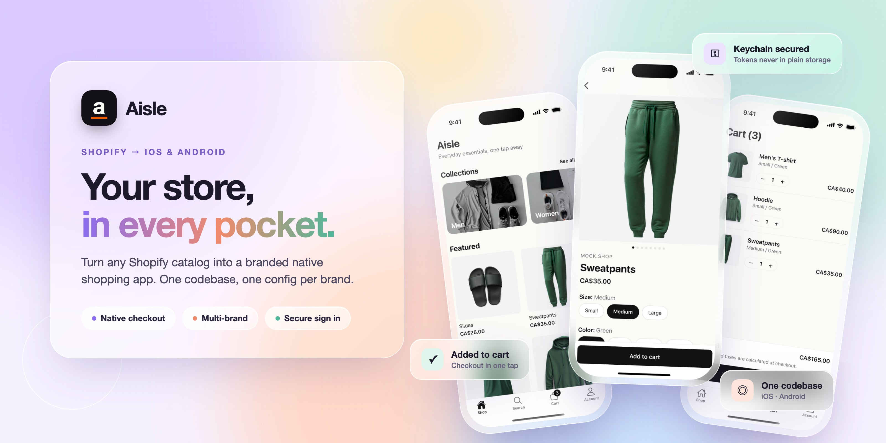
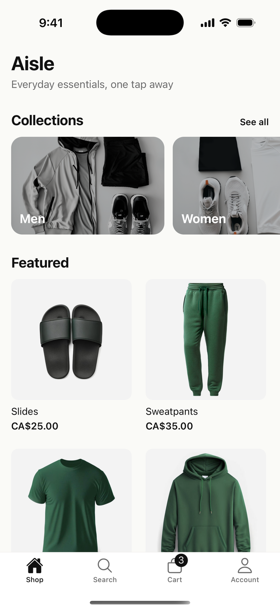
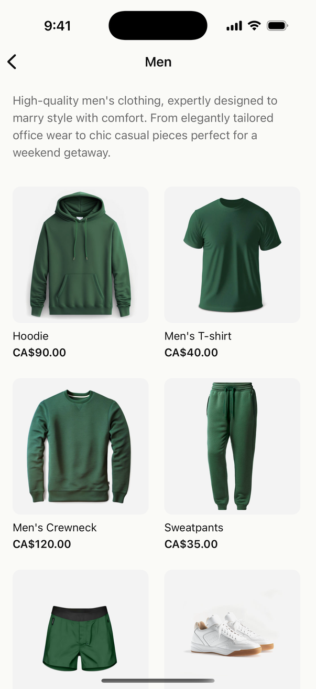
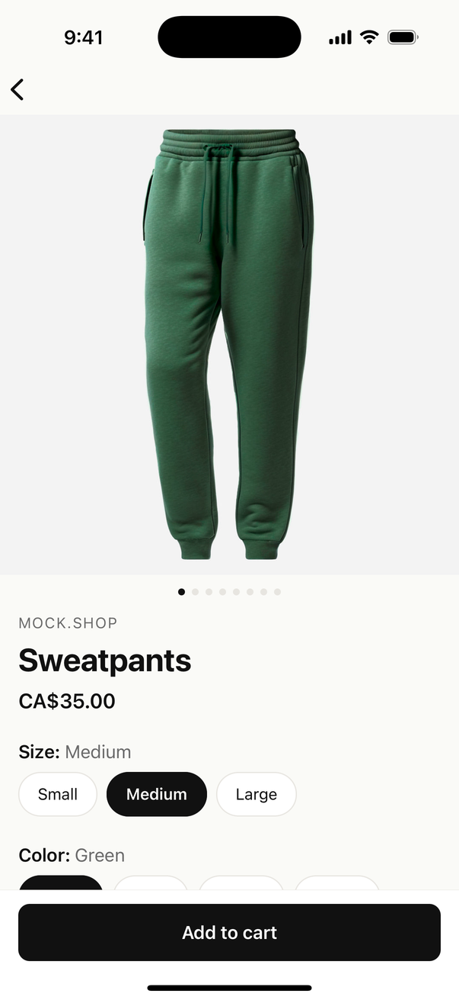
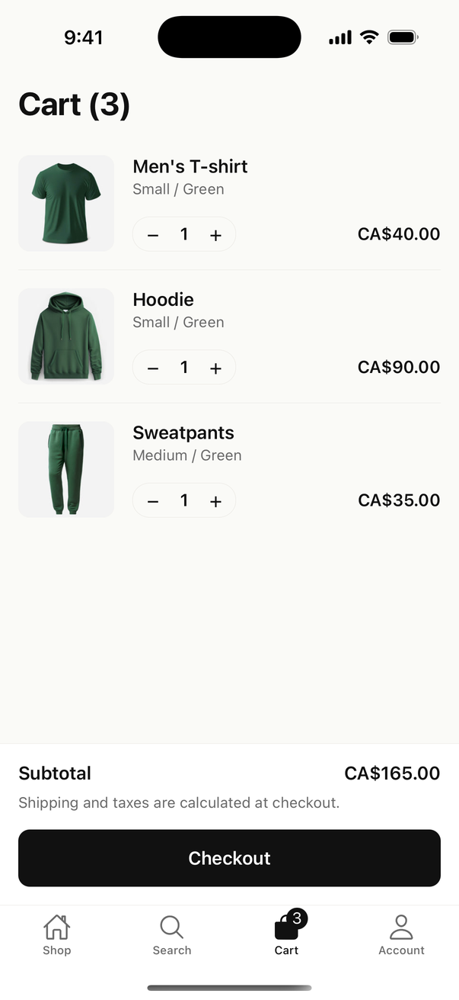
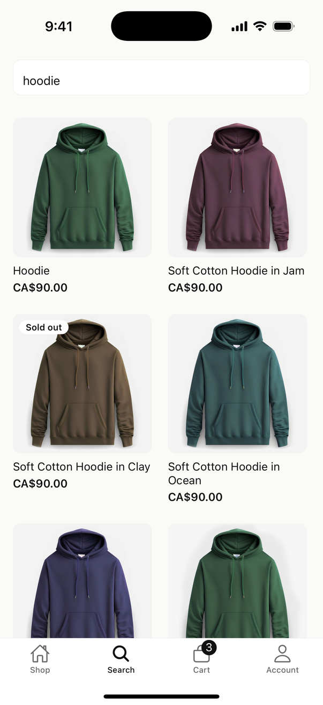
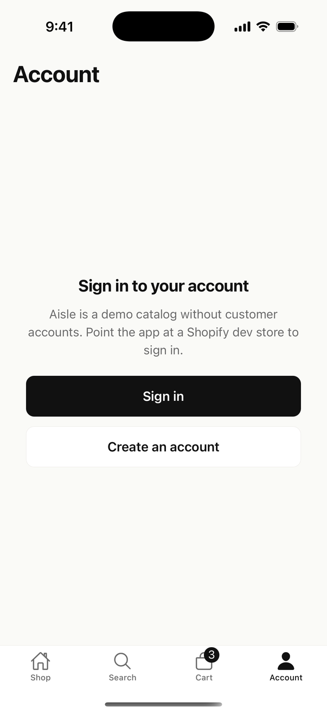

<div align="center">



<h1>Aisle</h1>

<p><strong>Your Shopify store, as a native iOS and Android app.</strong><br/>
One codebase. One config file per brand. Ship a shopping app without building one.</p>


</div>

---

## Why Aisle

Shoppers buy more in apps than on mobile websites, but a custom app costs a small Shopify merchant months of work. Most of that work is the same for every store: browsing, cart, checkout, accounts. Only a few things change from brand to brand: name, colors, logo, and which store the app talks to.

Aisle builds the shared parts once. Each brand is a small config file. Point Aisle at a store and you get a branded app with its own name, icon colors and catalog. The rest of the code stays the same.

## What shoppers get

**Browse the whole catalog.** The home screen shows featured collections and best sellers. Collections load more products as you scroll. Search finds products by name.

**Pick the right variant.** Product pages have a swipeable gallery and a size and color picker. Combinations that are sold out are crossed out, so nobody adds something that can't ship.

**Keep their cart.** Shoppers can add items, change quantities and remove items. The cart is still there after they close the app.

**Check out with Shopify.** Checkout runs on Shopify's own checkout sheet: the same payment methods, discounts and shipping rules the store already uses. The cart clears when the order goes through.

**Sign in and see past orders.** Shoppers can create an account or sign in, then browse their order history with totals, shipping address and tracking. Signed-in shoppers get their details filled in at checkout.

**Follow shared links.** `storefront://product/<handle>` and `storefront://collection/<handle>` open the right screen directly.

## What merchants get

- **A branded app from one file.** Name, tagline, logo, colors and store connection all live in `merchants/<brand>.ts`.
- **One codebase for every brand.** Change one env variable to build a different store. Each brand gets its own bundle id, so several brands can be installed on one device.
- **Secure by default.** Customer tokens live in the iOS Keychain and Android Keystore, never in plain storage.
- **Fast on real catalogs.** Shopify resizes every image on its servers, so grids download thumbnails and full-size images load only on the product page.

## Screenshots

| Home | Collection | Product | Cart |
|---|---|---|---|
|  |  |  |  |

| Search | Account |
|---|---|
|  |  |

## Try it

Aisle runs against [mock.shop](https://mock.shop), Shopify's public demo store, so you don't need an account or an API key. You need Node 20+ and Xcode or Android Studio.

1. `npm install`
2. `npm run ios` or `npm run android`

Aisle is an **Expo app using a development build**, not Expo Go. Checkout, secure storage and fast local storage need native modules that Expo Go doesn't include.

## Launch your own brand

1. Create a dev store from a [Shopify Partner](https://partners.shopify.com) account and add products.
2. Install the **Headless** sales channel and copy the public Storefront API token. Turn on the customer scopes if you want accounts.
3. `cp .env.example .env` and fill it in:
   ```sh
   EXPO_PUBLIC_MERCHANT=dev-store
   EXPO_PUBLIC_DEV_STORE_NAME=Acme Goods
   EXPO_PUBLIC_DEV_STORE_DOMAIN=acme.myshopify.com
   EXPO_PUBLIC_DEV_STORE_TOKEN=<storefront token>
   ```
4. `npx expo prebuild --clean && npm run ios`

For a permanent brand, add a file to `merchants/` and register it in `merchants/index.ts`:

```ts
const acme: MerchantConfig = {
  id: 'acme',
  appName: 'Acme Goods',
  tagline: 'Built to last',
  storeDomain: 'acme.myshopify.com',
  storefrontToken: '…',
  apiVersion: '2025-01',
  bundleSuffix: 'acme', // app.aisle.acme
  supportsCustomerAccounts: true,
  theme: { primary: '#0B5FFF', onPrimary: '#FFFFFF', background: '#F7F8FA', /* … */ },
};
```

> The mock.shop demo has the catalog and cart but no customer accounts. Use a dev store to try sign in and order history.

## Under the hood

| | |
|---|---|
| App | React Native, TypeScript, Expo dev build |
| Navigation | React Navigation with deep linking |
| Data | Shopify Storefront GraphQL API, TanStack Query, types generated with GraphQL Codegen |
| State | Zustand |
| Storage | [`@88khp/rn-storage-kit`](https://www.npmjs.com/package/@88khp/rn-storage-kit): MMKV for the cart, Keychain/Keystore for the session |
| Checkout | Shopify Checkout Sheet Kit |
| Quality | ESLint, strict TypeScript, GitHub Actions |

```
merchants/            one file per brand
app.config.ts         app name, icon colors and bundle id from the active brand
src/api/              Storefront client, GraphQL operations, generated types
src/hooks/            catalog, cart and account data
src/screens/          Home, Collection, Product, Search, Cart, Sign in, Sign up, Account, Order
```

`npm run lint` · `npm run typecheck` · `npm run codegen`

## Roadmap

Not in v1: reviews, loyalty, subscriptions, push notifications and offline browsing.

## License

[MIT](./LICENSE)
